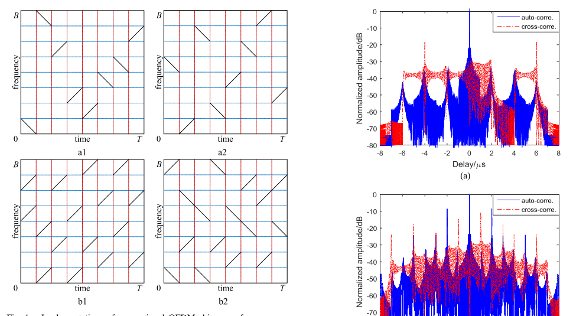
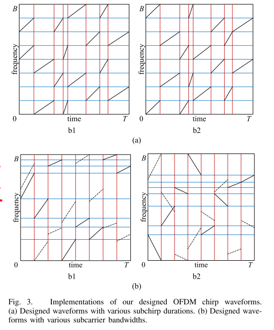
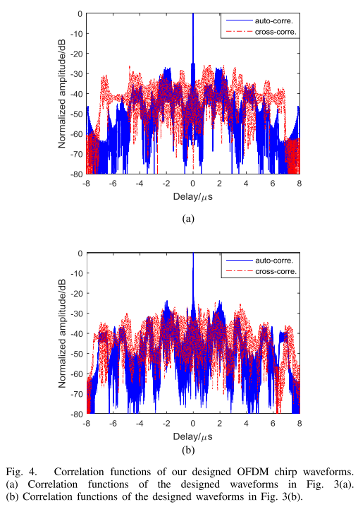
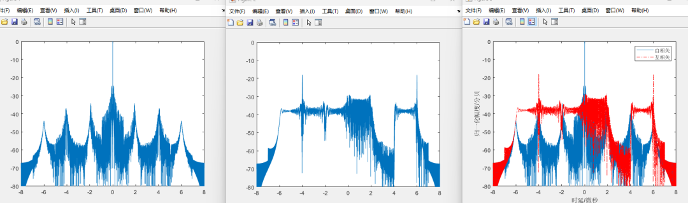
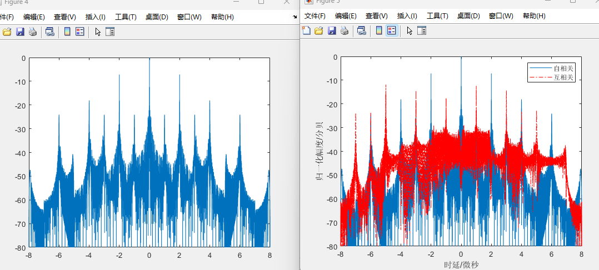

# MIMO Radar - OFDM Chirp Waveform Diversity Design for MIMO Radar Interference Reduction [with MATLAB Code]

Introduction: Multi-Input Multi-Output (MIMO) radars have garnered widespread attention due to their superior performance in detection and spatial resolution [1]-[3]. To achieve these advantages, the orthogonality of the transmitted waveform is essential [4]-[5]. Additionally, to meet application requirements, the waveform must possess certain additional characteristics, such as large time-bandwidth product, low peak-to-average power ratio, and no distance-Doppler coupling. Since OFDM linear frequency modulation signals can well satisfy some of these requirements, they have become a common waveform for MIMO radars.
To improve the range resolution of radar systems, OFDM signals were first proposed for higher bandwidth [6], and then became a hot topic of research involving blur functions [7], motion target detection performance [8]. One major issue with OFDM signals is the rapid change in signal envelope, and some optimizations have been implemented to reduce the Peak-to-Average Power Ratio (PAPR) [9], [10]. Due to the advantages of linear frequency modulation signals such as high range resolution, good Doppler tolerance, and constant modulus, they hold great potential in radar applications. Therefore, combining OFDM principles with chirp waveforms aims to address the high PAPR issue and improve Doppler tolerance performance. When applying OFDM linear frequency modulation waveforms to MIMO radar, multiple OFDM linear frequency modulation signals need to be generated based on the linear frequency modulation basis. Thus, a new design scheme for OFDM linear frequency modulation waveforms combined with modulation and demodulation algorithms for multiple transmitters in MIMO radar has been proposed [11], [12]. However, this approach does not fully consider correlation or blur functions, and generates orthogonal waves at the cost of linear frequency modulation repetition. Reference [13] analyzes the challenges of implementing OFDM linear frequency modulation waveforms in real systems and proposes a new signal processing algorithm to solve this problem. In [14], an effective design scheme is proposed including OFDM linear frequency modulation baseband design and random matrix modulation. The designed waveforms have advantages such as nearly constant time-domain and frequency-domain modulus, large time-bandwidth product, and low peak-to-average power ratio. However, there are some high correlation sidelobes that may lead to error detection. Considering the improvement in target detection performance, further suppression of correlated interference should be considered.
This paper analyzes the reason behind the high correlation sidelobes in traditional OFDM linear frequency modulation waveforms and proposes two new designs for OFDM linear frequency modulation waveform diversity to suppress correlated interference. The subchirp duration or subcarrier bandwidth is assumed to be different and specifically designed to suppress the high sidelobes of the correlated function.
Conclusion: OFDM linear frequency-modulation diversity waveforms have been widely used in MIMO radar due to their superiority in practical applications. However, their associated functions exhibit high sidelobes, severely impacting target detection. To eliminate the high sidelobes of the OFDM system and enhance target detection performance, this paper analyzes the reasons for the high sidelobes in the OFDM system and proposes two new designs for OFDM linear frequency-modulation diversity waveforms. The duration of various sub-linear frequency-modulated waves or different subcarrier bandwidths are optimized to reduce PSL. Numerical examples show that the designed waveforms have better correlation performance than conventional waveforms.
MATLAB Simulation Results

## Images

<!-- PAYMENT_BLOCK -->

## Get this dataset

- Payment link (Stripe): [Buy now](https://buy.stripe.com/3cs8yP7sY87d0vu9AB)
- Payment QR code: 

<!-- /PAYMENT_BLOCK -->
